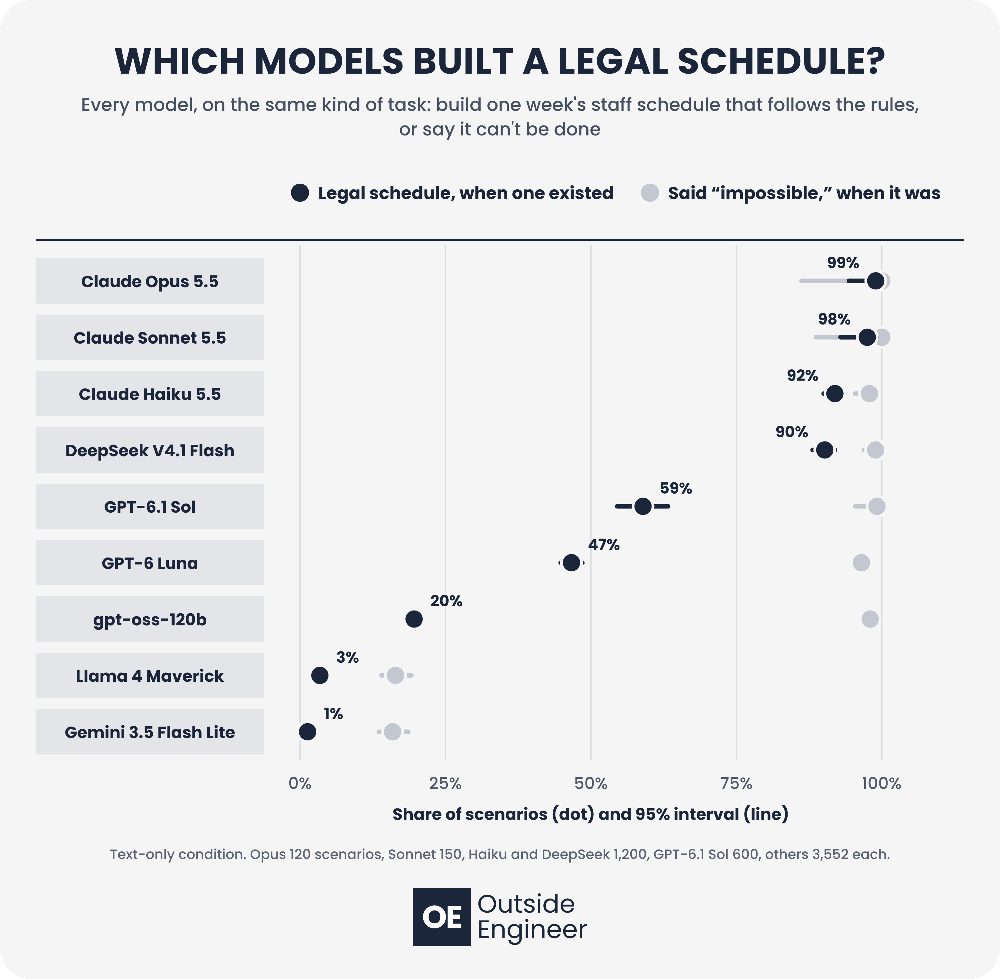

# Can AI Build a Legal Staff Schedule?

**Code, scenarios, answer key and full results for a study of whether AI models can build weekly staff schedules that follow U.S. labor rules**

📄 **Paper (preprint):** *Can AI Build a Legal Staff Schedule? Labor-Law Compliance of Nine Language Models on Small-Business Weekly Scheduling* (DOI to follow)

Nine models were asked to build one week's staff schedule for fictional cafés, retail shops and quick-service restaurants, or to answer `IMPOSSIBLE` when no schedule could follow every rule. The 592 businesses span five difficulty levels. Each one was run under three rule sets (federal only, California, Seattle chain store) and in two formats (a clean availability table, or casual text messages from staff): **3,552 scenarios, 17,478 graded answers.** A constraint solver supplied the answer key, and every answer was graded by code, not by another AI.

This is the third study in a series, after [Do AI Agents Check Their Work?](https://doi.org/10.5281/zenodo.23895152) ([code](https://github.com/brianna-rose05/crm-agent-bench)) and [Thinking Harder Doesn't Help AI Catch Silent Failures](https://doi.org/10.5281/zenodo.23895165) ([code](https://github.com/brianna-rose05/thinking-harder-silent-failures)).

## Results

| Model | Scenarios | Legal schedule, when one existed | Broke a labor law | Caught "impossible" | Cost per legal schedule |
|---|---:|---:|---:|---:|---:|
| Claude Opus 5.5 | 120 | 99.0% | 0.0% | 100% | 10.9¢ |
| Claude Sonnet 5.5 | 150 | 97.5% | 0.0% | 100% | 7.7¢ |
| Claude Haiku 5.5 | 1,200 | 91.9% | 0.8% | 97.9% | 1.2¢ |
| DeepSeek V4.1 Flash | 1,200 | 90.2% | 1.0% | 98.9% | 1.2¢ |
| GPT-6.1 Sol | 600 | 59.0% | 0.0% | 99.2% | 3.3¢ |
| GPT-6 Luna | 3,552 | 46.7% | 0.5% | 96.5% | 0.7¢ |
| gpt-oss-120b | 3,552 | 19.6% | 3.2% | 98.0% | 1.1¢ |
| Llama 4 Maverick | 3,552 | 3.4% | 34.0% | 16.4% | 8.0¢ |
| Gemini 3.5 Flash Lite | 3,552 | 1.3% | 31.2% | 15.9% | 16.9¢ |

*Legal schedule* and *broke a labor law* are shares of the scenarios where a legal schedule existed. *Caught "impossible"* is the share of impossible scenarios answered `IMPOSSIBLE`.

- **Three tiers.** The four top models nearly always built a legal schedule. GPT-6.1 Sol, GPT-6 Luna and gpt-oss-120b rarely broke labor law but often broke the business's own rules (most often scheduling people outside their stated availability), or wrongly answered "impossible." Llama 4 Maverick and Gemini 3.5 Flash Lite broke a labor law in about a third of scenarios, mostly teen-worker hours and missed California meal breaks.
- **Harder businesses, more mistakes.** Rule-breaking rose with difficulty for 7 of 9 models (odds ratio 1.60 per level).
- **More rules, more broken ones, for weaker models.** For the same business, 4 of 9 models broke labor rules or owed premium pay significantly more often under California and Seattle rules than under federal rules (Llama: 71% vs 31%).
- **Most models recognized impossible scenarios.** Seven of nine answered `IMPOSSIBLE` on at least 96.5% of them; Llama and Gemini returned a schedule for more than 80% instead.
- **A solver helped most.** With a Python tool that includes a constraint solver, GPT-6 Luna's violation rate fell from 53.8% to 5.4% and Gemini's from 86.5% to 13.5% on the same scenarios. Gemini then gave no usable answer on 21 of 24 impossible scenarios.
- The study cost **US$101.24** in API fees ($88.93 text-only runs, $7.27 code-tool runs, $5.04 pilot).

The full analysis output is in [`results/analysis/report.txt`](results/analysis/report.txt). Graphics for every result are in [`figures/`](figures).



## How it works

1. **Scenarios.** `generate.py` builds 600 businesses from seed 2026: 120 at each level, from 4–6 staff with one role (level 1) to 21–25 staff with shift leads, workers aged 15–17 and tight availability (level 5). Each business's shift needs are built backward from a hidden schedule that follows every rule of all three rule sets, so a legal schedule always exists. In 137 businesses (22.8%) an impossibility is then planted: the business needs more shift-lead hours than its shift leads can work. Availability messages are built from templates and checked to carry exactly the same information as the table.
2. **Answer key.** `solver.py` (Google OR-Tools CP-SAT, 5-second limit, 0.5% gap) decides for every business and rule set whether a schedule exists that breaks no rule and owes no premium pay, and finds the cheapest one. `build_answer_key.py` runs it on everything and confirms that every solver schedule passes the grader.
3. **Prompt.** `prompt.py` describes the business, staff, availability, shifts and rules in plain language, passes on the owner's instruction to avoid premium pay, and asks for one line per assignment (`EMPLOYEE_ID,SHIFT_ID,ROLE,MEAL`) between `<schedule>` tags, or `IMPOSSIBLE`.
4. **Grading.** `checker.py` checks every assignment against the rules for that rule set and prices any premium pay. Each answer gets one outcome: legal, breaks a labor law, breaks a business rule, premium pay, correctly impossible, falsely impossible, or no usable answer.

| Rule | Federal only | California | Seattle chain store |
|---|---|---|---|
| Weekly overtime | Over 40 h at 1.5× | Over 40 h at 1.5× | Over 40 h at 1.5× |
| Daily overtime | — | Over 8 h at 1.5×, over 12 h at 2× | — |
| Seventh day in a row | — | First 8 h at 1.5× | — |
| Meal periods | — | 30 min starting within the first 5 h; a second over 10 h; 1 hour's pay if missed | — |
| Ages 14–15 | Outside school hours; 3 h a school day, 18 h a school week, 8 h other days; 7:00–19:00 | Same | Same |
| Ages 16–17 | — | Outside school hours; 4 h a school day, 8 h other days, 48 h a week; 5:00–22:00 | — |
| Rest between shifts | — | — | Hours inside a gap under 10 h at 1.5× |

The rules were checked against [29 CFR 570.35](https://www.ecfr.gov/current/title-29/subtitle-B/chapter-V/subchapter-A/part-570/subpart-C/section-570.35), the [California Labor Commissioner](https://www.dir.ca.gov/dlse/FAQ_MealPeriods.html) and the [Seattle Secure Scheduling Ordinance](https://seattle.gov/documents/departments/laborstandards/key_requirements_ssso_04-23-17.pdf). This is a coded subset of real law for research, not legal advice.

## Repository layout

```
generate.py            builds the 600 businesses (scenarios/businesses.json)
rules.py               the three rule sets, as given to the model
solver.py              CP-SAT answer key for one business and rule set
build_answer_key.py    solves every business x rule set (scenarios/answer_key.json)
prompt.py              builds each prompt and parses each reply
checker.py             grades one schedule against one rule set
run.py                 text-only condition: runs models through OpenRouter; resumable
solver_run.py          code-tool condition: same prompt plus a run_python tool (OR-Tools installed)
grade.py               grades every reply in a results folder -> graded.csv
analysis.py            every statistic in the paper -> results/analysis/
tests/test_checker.py  59 grader tests: one planted violation per rule per rule set
PREREGISTRATION.md     hypotheses and analysis plan, committed before the main run
figures/               graphics for every result (make_figures.py rebuilds them)
scenarios/
  businesses.json      600 businesses: staff, availability (table and messages), shifts
  answer_key.json      feasible or not, cheapest legal cost and schedule, per business x rule set
results/
  main/                text-only run: one .jsonl per model (every reply, token use, cost) + graded.csv
  solver/              code-tool run, same layout
  pilot/ pilot_64k/    pilot runs (8 businesses, not analyzed)
  analysis/            analysis tables (.csv) and the full report (report.txt)
```

## Reproducing the study

Requires Python 3.10+ and, for the mixed-effects model, R with `lme4`.

```bash
pip install -r requirements.txt
python3 tests/test_checker.py          # grader tests, no API calls
python3 generate.py                    # rebuild scenarios/businesses.json
python3 build_answer_key.py            # rebuild scenarios/answer_key.json
```

To run models, copy `.env.example` to `.env` and add an [OpenRouter](https://openrouter.ai) key (or set `OPENROUTER_API_KEY`). Then:

```bash
python3 run.py --models openai/gpt-6-luna --instances main_120 --out results/main --max-spend 5
python3 solver_run.py --models openai/gpt-6-luna --instances main_120 --out results/solver
python3 grade.py results/main
python3 grade.py results/solver
python3 analysis.py
```

`--instances` takes `main` (all 3,552 scenarios) or a nested sample: `main_1200`, `main_600`, `main_300`, `main_150`, `main_120`. Every smaller sample sits inside every larger one. Runs are resumable: rerunning a command skips finished scenarios.

## Settings

| Setting | Value |
|---|---|
| Models (OpenRouter) | `anthropic/claude-opus-5.5`, `anthropic/claude-sonnet-5.5`, `anthropic/claude-haiku-5.5`, `deepseek/deepseek-v4.1-flash`, `openai/gpt-6.1-sol`, `openai/gpt-6-luna`, `openai/gpt-oss-120b`, `meta-llama/llama-4-maverick`, `google/gemini-3.5-flash-lite` |
| Samples | 3,552 scenarios for gpt-oss-120b, Gemini, Llama and GPT-6 Luna; 1,200 for Haiku and DeepSeek; 600 for GPT-6.1 Sol; 150 for Sonnet; 120 for Opus |
| Settings | Temperature 0, each model's default reasoning, up to 64,000 output tokens, one answer per scenario |
| Code tool | GPT-6 Luna on 300 scenarios, Gemini 3.5 Flash Lite on 120; up to 10 runs of 60 seconds each |
| Date run | November 2, 2026 |

## Notes

- **Analysis plan.** The hypotheses and analysis plan were committed before the main run, but the repository was made public after the run started, so the paper calls it a pre-specified analysis plan, not a preregistration. The tests for H1, H2 and H4 were chosen after a first look at the results.
- **Pilot changes.** The pilot (24 scenarios × 9 models) led to three changes before the main run: the parser accepts a reason after `IMPOSSIBLE` and a missing closing tag, the output limit went from 24,000 to 64,000 tokens, and sample sizes were set from measured costs.
- **Errors and cut-off replies.** Six of 17,478 text-only calls ended with a provider error and were graded as unusable, not dropped. Of 93 replies cut off at the output limit, 91 had no usable schedule; the other 2 were graded on the partial schedule they held.
- **Strict format.** Some replies used names instead of employee IDs, and the parser drops those lines. Re-grading with a lenient parser changed 16 of 17,478 outcomes and no model's legal rate by more than 0.1 points (`results/analysis/sensitivity_lenient.csv`).
- **Answer key timing.** 306 of the 1,389 solvable cases hit the 5-second limit before the 0.5% gap, so their "cheapest" cost is the best found. Rebuilding the answer key on other hardware can change those costs slightly, but not whether a schedule exists.
- **Code tool sandbox.** `solver_run.py` runs model-written code in a separate process with a time limit. The model is told it has no internet, but network access is not blocked, so run it only in an isolated environment.

## Citation

> Pischke, B. (2026). *Can AI Build a Legal Staff Schedule? Labor-Law Compliance of Nine Language Models on Small-Business Weekly Scheduling*. Preprint.

```bibtex
@misc{pischke2026legalschedule,
  author = {Pischke, BriAnna},
  title  = {Can AI Build a Legal Staff Schedule? Labor-Law Compliance of Nine Language Models on Small-Business Weekly Scheduling},
  year   = {2026},
  note   = {Preprint},
  url    = {https://github.com/brianna-rose05/legal-schedule-bench}
}
```
